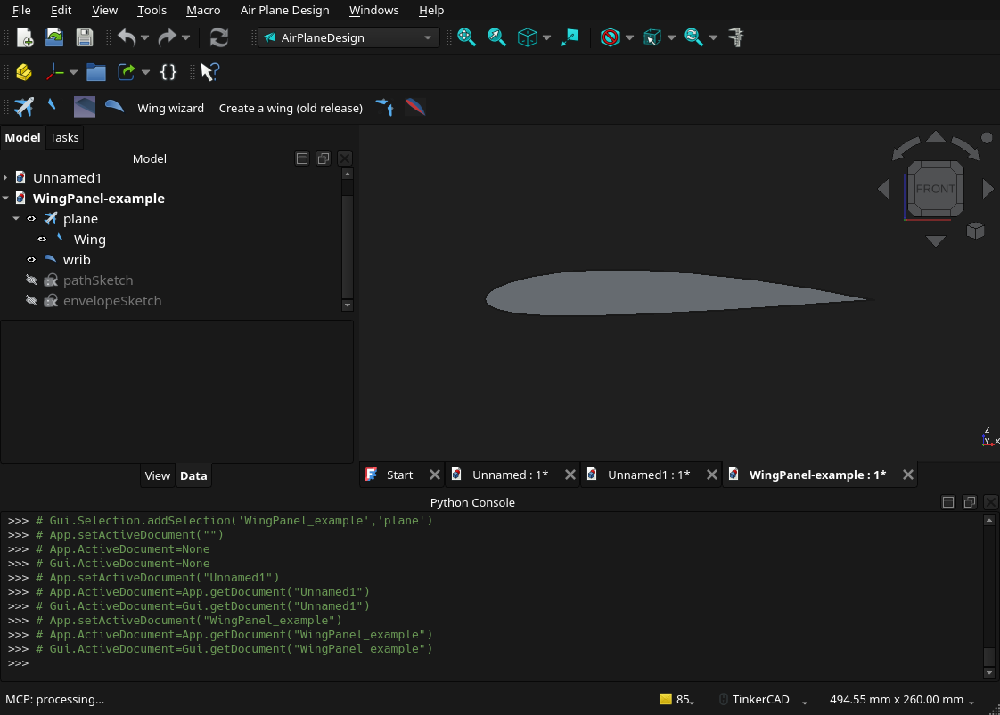
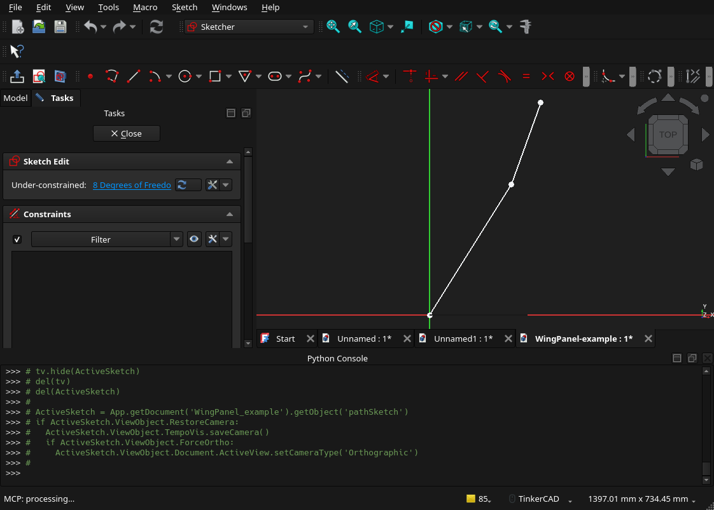
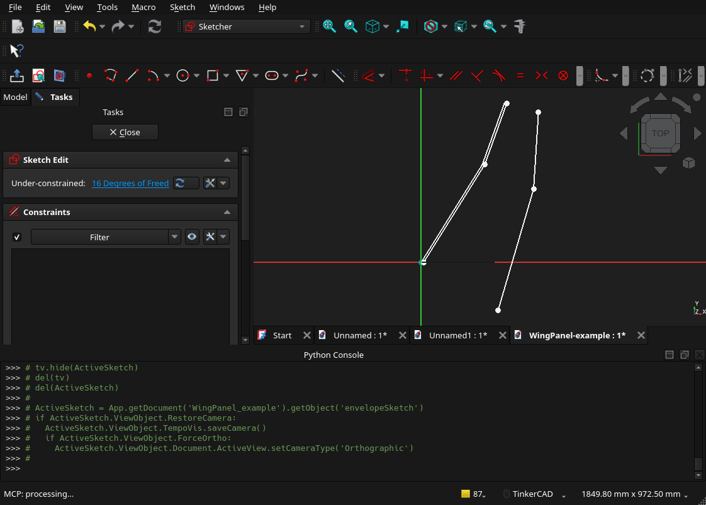
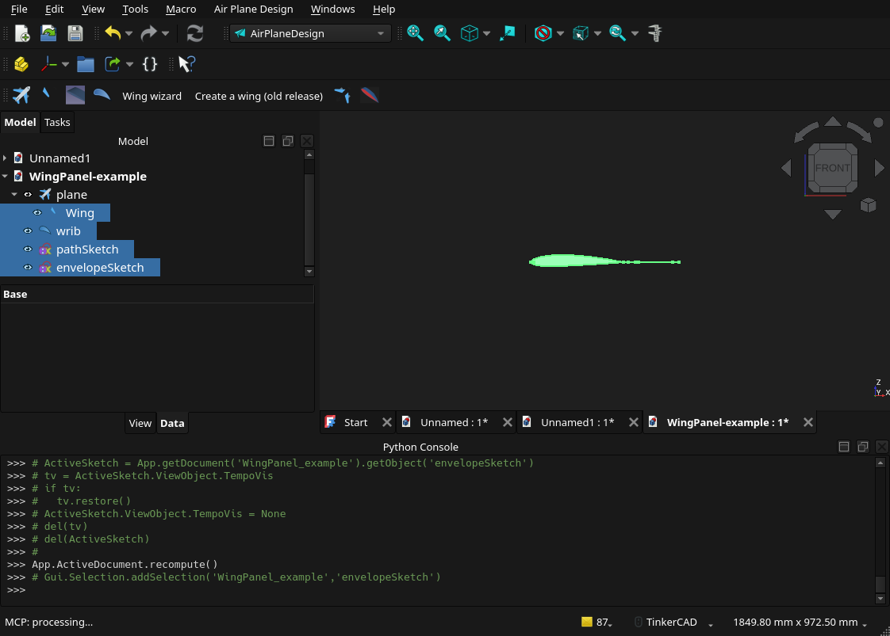
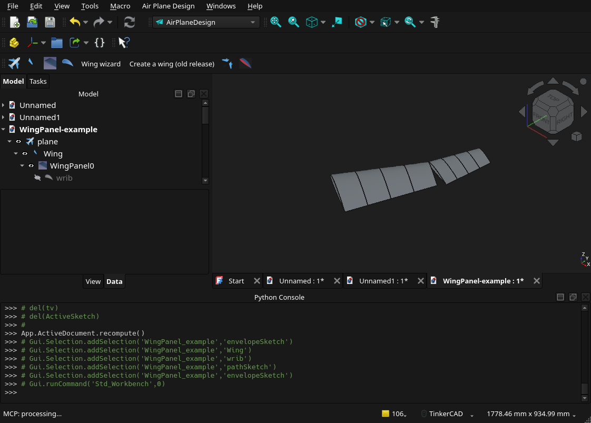

# Wing Panel

Build a wing panel by lofting ribs between a hand-drawn planform (a leading-edge and trailing-edge sketch) and a spanwise path sketch. One panel needs just three sketch lines: one path line plus two envelope edges (one leading, one trailing). This is the sketch-driven **Wing Panel** command, not the table-driven Wing Wizard.

Verified against `airPlaneWPanel.py`, FreeCAD 1.1.

Workbench convention throughout: **X is the chord direction (aft is positive), Y is the span (root to tip), Z is up.** Both sketches you draw are top-view drawings on the XY plane, and both stay at Z = 0 for a flat wing. (A path line's far end may be lifted in Z later if you want that panel to have dihedral; nothing else here uses Z.)

## Step 1: Plane and wing (AirPlaneDesign workbench)

Switch to the **AirPlaneDesign** workbench. Click **"Create a Plane"**. Then select the plane in the tree and click **"Create/Add a wing"**. Select the plane first or you get an orphan wing. Do not use the "Create a wing (old release)" button; it makes a solid slab, not the Wing object this command wants.


The root rib on its wing, front view. The wing shows as a flat shape until panels are added.

## Step 2: Root rib (AirPlaneDesign workbench)

Click **"Create a Rib"**. No selection is needed. In the dialog pick the NACA tab, type `2412`, and set any chord (300 mm). This rib only supplies the airfoil shape and the reference direction every generated rib is measured against; its chord and position do not size the panel, the envelope does. Leave it flat with default placement. It gets hidden automatically when you run the panel command.

## Step 3: Path sketch (Sketcher workbench)

Switch to **Sketcher**. Create a new sketch and choose the **XY plane** in the dialog that opens. Do not attach it to a face or datum plane, and leave its Placement at the default (position 0,0,0, no rotation): the command copies the sketch's own orientation onto everything it generates, so a tilted sketch tilts every rib.

Draw one straight line per panel, running from root toward tip, entirely at Z = 0. For a single panel, draw exactly one line. The line's direction sets the rib angle for that panel, so tilt it in the XY view to add sweep. Start the line at the root end and make it **at least as long as** that panel's leading-edge segment; ribs are spaced along it from its start point. A shorter path pulls the last ribs inboard onto its end point (the console warns), which stacks duplicate ribs and blocks the skin.

For two or more panels, draw the lines joined tip-to-root into one continuous polyline, not separate floating lines. The command only reads the first connected group of edges, so disjoint lines build one panel and then fail.

Worked example, a single-panel path: one line from `(0, 0)` to `(250, 400)`. To make it two panels, add a second segment from `(250, 400)` to `(340, 650)`, joined at the shared point.


A two-segment path polyline in Sketcher, top view: root segment from below the X axis up to the red break point, tip segment continuing to the top vertex. Two segments means two panels; a single line is a complete one-panel path.

## Step 4: Envelope sketch (Sketcher workbench)

Create another sketch, again on the **XY plane** with default Placement. Draw it entirely at Z = 0.

Draw the wing outline as two separate open lines that never touch: a leading-edge line and a trailing-edge line. For a single panel that is all it takes, one leading-edge line and one trailing-edge line; the dialog's "exactly 2 edges" is literally true for one panel. Keep a clear gap at the root end and the tip end so the two lines do not join into a closed loop.

Rules that matter:

- Draw the leading-edge line first. The command treats the group containing your first-drawn edge as the leading edge. A group, or chain, is a set of edges connected end to end.
- Do not close the outline. A closed loop collapses to one group and the command crashes with no message, leaving half-built objects you cannot undo.
- Keep both chains fully on the positive-X side of the Y axis. Rib chord is measured as the width along global X, so a chain that crosses X = 0 gives ribs a zero or wrong chord and they get dropped with `Error : not bbox`.
- For more than one panel, split both the leading edge and the trailing edge into the same number of segments at the panel break, matching where the path polyline bends. The panel count equals the number of edges in the leading-edge group, so the leading-edge count, trailing-edge count, and path-segment count must all match.

Worked example, draw order 1 then 2 for one panel:

```
LE: (0, 0)    -> (250, 400)     # edge 1, draw first
TE: (300, 0)  -> (550, 400)     # edge 2, one-panel envelope done
```

For two panels extend both: LE continues `(250, 400) -> (340, 650)` and TE continues `(550, 400) -> (430, 650)`, giving two edges each.


A two-panel envelope in Sketcher: leading-edge chain on the left (two edges joined at its red break point), trailing-edge chain on the right (two edges joined at its red break point), gaps open at root and tip. Note both chains sit to the right of the vertical Y axis, as required above.

## Step 5: Run it (back to AirPlaneDesign workbench)

Before running, the tree should show `plane` > `Wing001`, the root rib `wrib`, and your two sketches. Select the four objects **in this order**: Wing, root rib, path sketch, envelope sketch. The tooltip should read `airPlaneDesignWingPanel`.


The four objects selected in order (highlighted blue): Wing001, wrib, Sketch (path), Sketch001 (envelope). Tooltip shows `airPlaneDesignWingPanel`.

Click **"Wing Panel"**. For each panel you get sketches `path<i>`, `leadInEdges<i>`, `trailingEdge<i>`, and a `WingPanel<i>` object with child ribs; the console prints `Number of Panels :N`. The command switches you to the Draft workbench when it finishes, so switch back to AirPlaneDesign.


After a two-panel run: the tree has grown `path0`/`leadInEdges0`/`trailingEdge0`/`WingPanel0` (and the same for panel 1) under the wing. In this capture the skins did not build, so only the rib lofts are visible; see "Why you see ribs but no wing skin" below. If you see only the two sketches, the command did not complete at all; check the Report view.

### Why you see ribs but no wing skin

The lofts in the screenshot above are the **rib sets** (each `WingPanel<i>` holds five airfoil ribs). The smooth wing surface that should stretch across them is a separate shape on the `WingPanel` object, and it only builds when every rib in the panel has a valid chord. One degenerate rib collapses the whole skin to nothing:

- If a rib's slice plane (the plane through the rib's station on the path, along which its chord is measured) misses the trailing edge, that rib gets a zero chord (`Chord = 0.0000001 mm` in its Data tab) and becomes an empty shape. The panel then has no faces at all, and you see loose ribs or nothing.
- A missing skin with otherwise healthy ribs can also mean `WingPanel0` is simply hidden: select it, press spacebar, and orbit to a 3/4 view (in top view the flat skin renders edge-on and looks invisible).

To check which case you are in: click a `Rib` object and look at `Chord` in the Data tab. A real chord (tens or hundreds of mm) with no skin means visibility; `0.0000001` means the envelope geometry failed the slice test, so lengthen or shift the trailing-edge segments per Step 4 and change `Items` on the panel to force a rebuild.

This screenshot predates a fix in `airPlaneWPanel.py`: the command now spaces rib stations only across the span where the slice plane actually crosses the trailing edge, skips any rib that still comes out degenerate (with a console warning naming the panel and station), and refuses to loft over fewer than two valid ribs instead of silently producing an empty skin. Re-run the command on a current build and both panels should get real skins; if a warning says a station was skipped, lengthen or shift the trailing edge there.

Properties on each `WingPanel`: `Items` is the rib count per panel (default 5; changing it rebuilds all ribs) and `OffsetStart`/`OffsetEnd` trim the ends; changing `Twist` or `TipTwist` also rebuilds all ribs. `Distribution`, `Solid`, `Surface`, and `Dihedral` do nothing in this command (`Dihedral` is unimplemented: rotate the wing about its root chord line yourself, or lift one end of the panel's path line).
`Twist` is the root-section rotation and `TipTwist` the extra rotation toward the tip, both in degrees about the rib normal: a rib at span fraction `f` (0 root, 1 tip) sits at `Twist + f*TipTwist`. In the workbench frame (X chord aft, Y span to tip, Z up) a **negative** `TipTwist` raises the tip's trailing edge - washout, the same sign convention as the cavity-station helpers. The hinge is the leading edge: it stays on your LE sketch line while the TE moves. Save before running: a failed run leaves partial objects and there is no undo for this command. The traceback that prints at the end of a successful run is a known cosmetic bug; ignore it.

## Troubleshooting

| Symptom | Cause and fix |
|---|---|
| Popup with usage text | Wrong selection count or order. Select Wing, root rib, path sketch, envelope sketch, in that order. |
| Crash, no message, half-built objects | Envelope is a closed loop. Open it: leave gaps at root and tip. |
| One panel built, then crash with orphans left over | Path has more segments than the leading-edge group has edges. Make LE edge count, TE edge count, and path segment count equal. |
| Fewer panels than you expected | Panel count equals the leading-edge edge count. Split the leading edge (and trailing edge) at each panel break. |
| `Error : not bbox` or missing/flat ribs | A rib's slice plane missed the trailing edge: that rib gets chord 0.0000001 and the panel skin fails to build. Lengthen or shift the trailing-edge segments so every tilted slice crosses them; change `Items` to rebuild. |
| Ribs visible but no wing skin | Read the Report view: the command now names the cause (`path sketch segment is shorter...`, `duplicate position`, or `skin not built`). A short path stacks duplicate ribs at its end point; lengthen the path segment past the leading-edge segment, then set `Items` to 4 and back to 5 to rebuild. Also rule out visibility, see "Why you see ribs but no wing skin" above. |
| Ribs tilted wrong or panels mis-oriented | A sketch is not on the XY plane with default placement, or the path was drawn tip-to-root instead of root-to-tip. |
